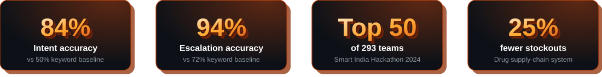

  

  

I'm a Computer Science graduate (B.Tech, 2026, CGPA 8.7) from Jaipur. I build software **end to end**: data model → REST API → UI → deployment.

My recent work sits where full-stack meets applied AI: a **vision-LLM radiology assistant** with a doctor-in-the-loop review flow, and an **LLM support agent** with RAG and a measured evaluation harness. I care about grounded outputs, safe failure behavior, and numbers that prove a system works.

  

 

 

  

**AI / ML** 

**Engineering** 

 

  

<table>
<tr>
<td width="50%" align="center"></td>
<td width="50%" align="center"></td>
</tr>
<tr>
<td width="50%" align="center"></td>
<td width="50%" align="center"></td>
</tr>
</table>

<!-- TODO: Live demo button for Medical AI Assistant ->  -->

 

  

  

  

  

  

 

  

  

  

