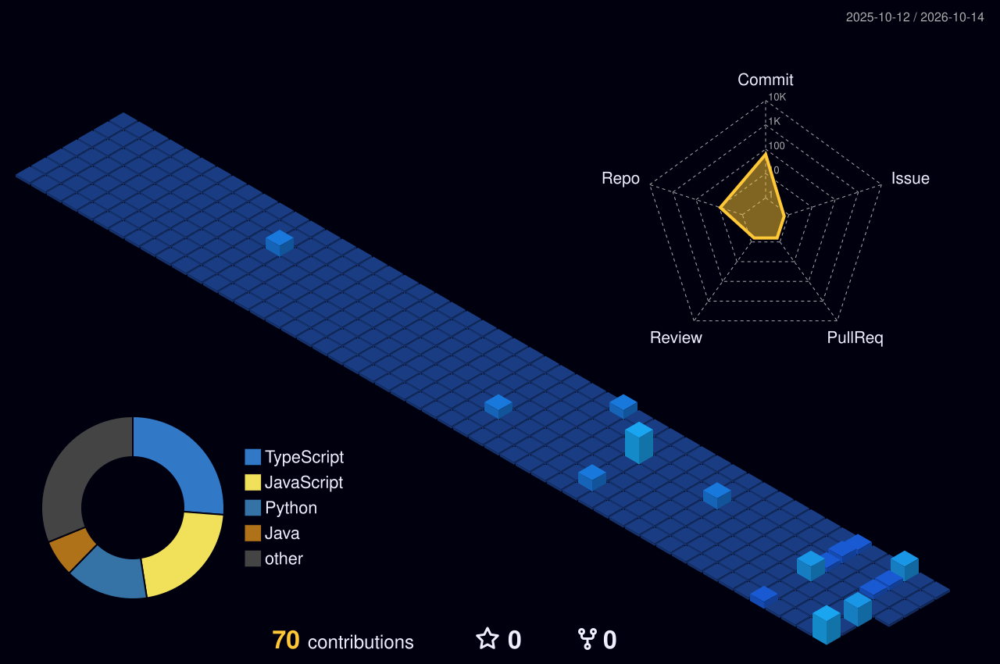

<div align="center">



<a href="https://www.linkedin.com/in/riya-vaishnav-1a799024a"></a>
<a href="mailto:kanhavaishnav2010@gmail.com"></a>
<a href="https://leetcode.com/u/riya_2005"></a>


</div>

## 👩‍💻 About

I'm a Computer Science graduate (B.Tech, 2026, CGPA 8.7) from Jaipur. I build software **end to end**: data model → REST API → UI → deployment.

My recent work sits where full-stack meets applied AI: a **vision-LLM radiology assistant** with a doctor-in-the-loop review flow, and an **LLM support agent** with RAG and a measured evaluation harness. I care about grounded outputs, safe failure behavior, and numbers that prove a system works.

```python
class Riya:
    role      = "Software Developer · GenAI & Full-Stack Engineer"
    based_in  = "Jaipur, India"
    strengths = ["DSA", "OOP", "DBMS", "REST APIs", "JWT auth", "LLM evaluation"]
    shipped   = ["Medical AI Assistant", "AppleSupport AI Agent", "SIH 2024 (Top 50/293)"]
    looking_for = "Entry-level SDE / Full-Stack / GenAI Engineer roles"
```

<div align="center"></div>

## 🧰 Tech Stack

<div align="center">

<br>


</div>

**AI / ML:** 


**Engineering:** 


<div align="center"></div>

## 🚀 Featured Projects

<table>
<tr>
<td width="50%" valign="top">

### 🩻 Medical AI Assistant
**AI-powered radiology report generator**

A **vision LLM (Gemini)** drafts findings and an impression from an uploaded scan; a **doctor reviews, edits and approves** the final report. The AI never produces the final report.

- FastAPI + SQLAlchemy + PostgreSQL REST API
- **JWT (bcrypt) + role-based access**: only doctors finalize or delete
- Non-medical images are **flagged, not reported as "normal"**
- DRAFT/FINAL PDF export (ReportLab, Pillow)
- React + Tailwind UI; deployed on **Render + Vercel**

`React` `FastAPI` `PostgreSQL` `Gemini Vision` `JWT` `Tailwind`

[](https://github.com/Riya2005-vaishnav/medical-ai-assistant)
<!-- TODO: [](YOUR_VERCEL_URL) -->

</td>
<td width="50%" valign="top">

### 🍎 AppleSupport AI Agent
**LLM-powered support triage and reply drafting**

Classifies messages into **7 intents** (discovered by clustering real customer messages), **retrieves similar past resolutions (RAG)**, drafts a grounded reply, and decides **auto-handle vs. escalate**, biased toward escalating when uncertain.

- Local embedding index (sentence-transformers), no API quota needed
- **206-row golden set**, plus keyword and majority-class baselines
- **LLM-as-a-judge** harness audited against human labels (75% agreement)
- Documented failure modes and a 15-entry decision log

`Python` `Gemini` `RAG` `sentence-transformers` `pandas`

[](https://github.com/Riya2005-vaishnav/Apple-Support-AI-Agent)

</td>
</tr>
</table>

<div align="center">

| 📊 AppleSupport AI Agent: golden-set results | Majority baseline | Keyword baseline | **Agent** |
|---|:---:|:---:|:---:|
| Intent accuracy | 30% | 50% | **84%** |
| Escalation accuracy | 60% | 72% | **94%** |

</div>

<table>
<tr>
<td width="50%" valign="top">

### 💊 Drug Inventory & Supply Chain Tracker
**Smart India Hackathon 2024: Top 50 of 293 teams**

Designed the relational MySQL schema and queries linking district hospitals to warehouses, **reducing stockouts by 25%**. Delivered a deployable full-stack system with a team.

`Python` `Java` `MySQL` `React.js`

</td>
<td width="50%" valign="top">

### ✈️ Travel Planner Web App
**Itinerary and budget management**

Node.js backend and React frontend for trip planning and budgets, with persistent storage in **MongoDB Atlas**.

`React.js` `Node.js` `MongoDB Atlas`

</td>
</tr>
</table>

<div align="center"></div>

## 🧊 3D Contribution Graph

<div align="center">

<!-- Generated daily by .github/workflows/3d-contrib.yml. Appears after the first workflow run. -->


</div>

## 📈 GitHub Stats

<div align="center">


<br>


</div>

## 🏆 Achievements

- 🥇 **Smart India Hackathon 2024**: Top 50 of 293 teams (Certificate of Consolation)
- 📜 **IBM SkillBuild**: Python 101 for Data Science (Jul 2025)
- 📜 **NPTEL**: Soft Skills (2024)

<div align="center">


</div>
